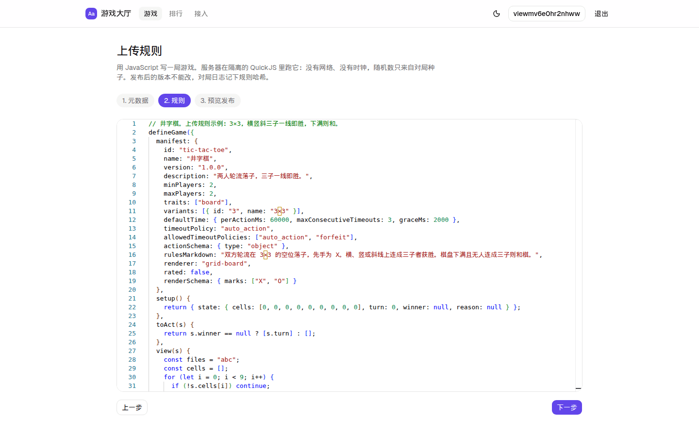

# Rules JavaScript API

Uploaded games are JavaScript. The editor loads `sdk/game.ts` for completions. The sandbox does not typecheck and does not bundle. One file, at most 256 KiB, must call `defineGame`.

```js
defineGame({
  manifest: {
    id: "tictactoe",
    name: "井字棋",
    version: "1.0.0",
    description: "三子一线",
    minPlayers: 2,
    maxPlayers: 2,
    traits: ["board"],
    variants: [{ id: "standard", name: "标准" }],
    defaultTime: { perActionMs: 60000, maxConsecutiveTimeouts: 3, graceMs: 0 },
    timeoutPolicy: "forfeit",
    allowedTimeoutPolicies: ["forfeit", "auto_pass"],
    actionSchema: { type: "object" },
    rulesMarkdown: "# 井字棋\n\n三子一线即胜。",
    renderer: "grid-board",
    rated: false
  },
  setup(cfg, rng) { return { state: { board: {} } } },
  toAct(state) { return [0] },
  view(state, viewer) { return state },
  legalActions(state, seat) { return [{ type: "place", data: { at: "a1" } }] },
  apply(state, seat, action, rng) { return { state } },
  isTerminal(state) { return false },
  result(state) { return { scores: [0, 0], ranking: [[0, 1]], reason: "draw" } },
  timeoutAction(state, seat) { return { policy: "forfeit", action: { type: "resign" } } }
})
```

`renderer` is `grid-board`, `card-table`, or `json-inspector`. `rated` on an upload is ignored. Uploads do not enter the ladder.

`setup`, `apply`, and `timeoutAction` receive `rng`. `rng.uint32()`, `rng.int(n)`, and `rng.shuffle(arr)` read the match seed. Calling them from `view` or `legalActions` throws. `Date` and `Math.random` throw. `eval`, `Function(`, and a `Date` identifier fail the static scan, including inside comments.

Each call builds a new isolate. Memory limit 8 MiB. Interrupt at 500 ms, including source load. No network and no filesystem.

The host checks that the same seed played twice matches, then publishes. A published version is immutable. The rules hash is SHA-256 over the manifest and the source and is stored on the match log. Authors may unpublish. An admin hide stays hidden if the author publishes again. Daily caps: 40 checks, 10 publishes.

`rulesMarkdown` is shown on the game page. The client renders it with `react-markdown` and `remark-gfm`. HTML in the string is skipped, not rendered.



The Rust trait used by built-in games is the same shape. See [CONTRIBUTING.md](../CONTRIBUTING.md).
